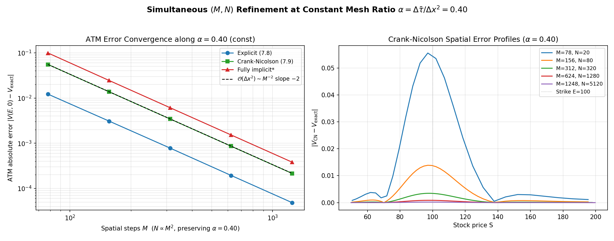
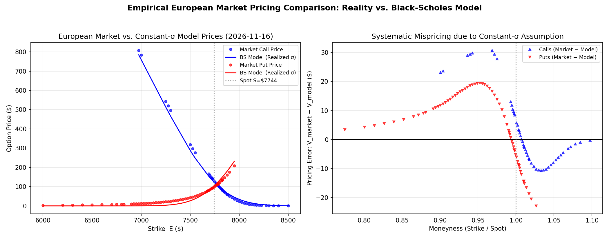

# Black-Scholes to Market: PDE Finite Difference Solvers, Empirical SPX Calibration, & Literature Error Relaxation

[](https://www.python.org/downloads/)
[](LICENSE)
[](#)
[](#)

A quantitative finance framework connecting mathematical PDE theory to real-world options markets:
1. Analytical **Black-Scholes-Merton (1973)** PDE and its transformation into the **1D Heat Diffusion Equation** (Zhu et al., 2013).
2. Numerical **Finite Difference Methods (FDM)** — Explicit FTCS ($\mathcal{O}(\Delta\tau + \Delta x^2)$), Crank-Nicolson ($\mathcal{O}(\Delta\tau^2 + \Delta x^2)$), and Fully Implicit BTCS ($\mathcal{O}(\Delta\tau + \Delta x^2)$) — with von Neumann stability and spacetime convergence verification.
3. **Empirical European Market Calibration** on **1,337 European S&P 500 (`^SPX`)** option quotes from a static market snapshot (October 16, 2026) across 3 maturities, utilizing put-call parity to infer market-implied forward prices and eliminate artificial call/put implied volatility discrepancies.
4. **Progressive Error Relaxation** using literature models (**Leland 1985**, **ATM Calibration**, **Smile-Interpolated BS**, and **Merton 1976 Jump-Diffusion**), evaluated with both in-sample metrics, 5-fold cross-validation out-of-sample testing, and Leave-One-Expiry-Out (LOEO) cross-maturity evaluation.

---

## Table of Contents

- [Project Architecture](#project-architecture)
- [Theoretical Formulation](#theoretical-formulation)
  - [The Black-Scholes PDE](#the-black-scholes-pde)
  - [Transformation to Constant-Coefficient Heat Equation](#transformation-to-constant-coefficient-heat-equation)
- [Numerical Schemes & Convergence](#numerical-schemes-and-convergence)
  - [Finite Difference Implementations](#finite-difference-implementations)
  - [Numerical Stability & Spacetime Surface](#numerical-stability-and-spacetime-surface)
- [Empirical Market Validation (^SPX Index Options)](#empirical-market-validation-spx-index-options)
  - [Why European ^SPX Options?](#why-european-spx-options)
  - [Put-Call Parity Forward Inference & Volatility Smile](#put-call-parity-forward-inference-and-volatility-smile)
  - [Diffusion-Scaled FDM Grid Consistency](#diffusion-scaled-fdm-grid-consistency)
- [Literature Extensions & Progressive Error Relaxation](#literature-extensions-and-progressive-error-relaxation)
  - [Models & Assumptions Relaxed](#models-and-assumptions-relaxed)
  - [Benchmark Results (In-Sample & 5-Fold Cross-Validation)](#benchmark-results-in-sample-and-5-fold-cross-validation)
  - [Economic Interpretation of Residual Error](#economic-interpretation-of-residual-error)
  - [Limitations](#limitations)
- [Installation & Quick Start](#installation-and-quick-start)
- [References](#references)
- [License](#license)

---

## Project Architecture

```
BSM-to-Market/
├── src/                          # Core numerical algorithms and calibration models
│   ├── bs_analytical.py          # Analytical Black-Scholes European pricing and Greeks
│   ├── heat_transform.py         # Coordinate mappings between financial and heat domains
│   ├── fdm_heat.py               # Finite Difference Solvers (Explicit, Crank-Nicolson, Implicit)
│   ├── iv_utils.py               # Put-call parity forward solver, Brent's IV inverter, vectorized pricer
│   ├── main.py                   # PDE validation, stability, and convergence studies
│   ├── fetch_market_data.py      # European ^SPX option chain & historical price downloader
│   ├── market_validation.py      # Empirical European market benchmarking & IV surface analysis
│   └── model_extensions.py       # Literature models (Leland, ATM VRP, Smile-Interp, Merton Jumps)
│
├── data/                         # Real-world market datasets (Snapshot: October 16, 2026)
│   ├── spx_options_market_data.csv # 1,337 traded European SPX option quotes across 3 maturities
│   └── spx_underlying_history.csv  # 1-year historical daily closes for S&P 500 index
│
├── figures/                      # High-resolution generated plots and diagnostic figures
│   ├── prices_comparison.png     # FDM curves overlaid on analytical Black-Scholes
│   ├── error_analysis.png        # Time and space convergence rates (orders O(Δτ), O(Δτ²), and O(Δx²))
│   ├── heat_solution_surface.png # 3D spacetime heat solution surface u(x, τ̄)
│   ├── stability_demo.png        # Von Neumann numerical stability criterion (α ≤ 1/2)
│   ├── constant_alpha_analysis.png # Simultaneous (M, N) refinement at constant α = 0.40
│   ├── market_volatility_smile.png # Empirical European SPX volatility skew from OTM options
│   ├── market_pricing_errors.png # European market vs. constant-σ pricing errors across moneyness
│   ├── market_iv_surface.png     # 3D Implied Volatility Surface σ_imp(K/F, T) for ^SPX
│   ├── research_models_error_reduction.png # Progressive RMSE/MAE drops across literature models
│   └── research_models_price_fit.png       # Fit comparison across strikes & elimination of put skew error
│
├── .gitignore                    # Python, virtual environments, and cache exclusions
├── LICENSE                       # MIT License
├── requirements.txt              # Dependencies (numpy, scipy, matplotlib, pandas, yfinance)
└── README.md
```

---

## Theoretical Formulation

### The Black-Scholes PDE

Under risk-neutral valuation with continuous dividend yield $D_0$, the price of a European call option $V(S, t)$ satisfies (Zhu et al. Eq. 2.73):

$$\frac{\partial V}{\partial t} + \frac{1}{2}\sigma^2 S^2 \frac{\partial^2 V}{\partial S^2} + (r - D_0) S \frac{\partial V}{\partial S} - rV = 0, \qquad V(S,T) = \max(S - E, 0)$$

### Transformation to Constant-Coefficient Heat Equation

Following Zhu et al. (§2.6.1), we apply dimensionless coordinate transformations:

$$x = \ln(S/E) + \left(r - D_0 - \frac{1}{2}\sigma^2\right)(T-t), \qquad \bar\tau = \frac{1}{2}\sigma^2 (T-t), \qquad V(S,t) = E\, e^{-r(T-t)}\, u(x,\bar\tau)$$

This transforms the variable-coefficient parabolic PDE into the canonical 1D heat diffusion equation:

$$\frac{\partial u}{\partial \bar\tau} = \frac{\partial^2 u}{\partial x^2}, \qquad u(x,0) = \max\left(e^x - 1, 0\right)$$

with truncated Dirichlet boundaries on $[x_l, x_u]$:

$$u(x_l,\bar\tau) = 0, \qquad u(x_u,\bar\tau) = e^{x_u + \bar\tau} - 1$$

*Derivation of Upper Boundary:* As $S \to \infty$, the asymptotic European call value is $V(S, t) \sim S e^{-D_0(T-t)} - E e^{-r(T-t)}$. Dividing by $E e^{-r(T-t)}$ and substituting $S/E = e^{x - \mu(T-t)}$ with $\mu = r - D_0 - \frac{1}{2}\sigma^2$ yields $u(x_u, \bar\tau) = e^{x_u + \bar\tau} - 1$, eliminating $r$ and $D_0$ completely from the upper boundary.

---

## Numerical Schemes and Convergence

### Finite Difference Implementations

Discretizing on spatial mesh $x_m = x_l + m\Delta x$ and temporal mesh $\bar\tau_n = n\Delta\bar\tau$ with mesh ratio $\alpha = \frac{\Delta\bar\tau}{\Delta x^2}$:

1. **Explicit FTCS (Forward Time, Centered Space):**
   $$u_m^{n+1} = \alpha u_{m+1}^n + (1 - 2\alpha)u_m^n + \alpha u_{m-1}^n$$
   *Stability:* Conditionally stable iff $\alpha \le \frac{1}{2}$ (Von Neumann criterion). Truncation error is $\mathcal{O}(\Delta\bar\tau + \Delta x^2)$.

2. **Crank-Nicolson (Trapezoidal Scheme):**
   $$-\frac{\alpha}{2}u_{m-1}^{n+1} + (1+\alpha)u_m^{n+1} - \frac{\alpha}{2}u_{m+1}^{n+1} = \frac{\alpha}{2}u_{m-1}^n + (1-\alpha)u_m^n + \frac{\alpha}{2}u_{m+1}^n$$
   *Properties:* Unconditionally stable, tridiagonal linear system solved in $\mathcal{O}(M)$ time via Thomas algorithm, second-order accurate $\mathcal{O}(\Delta\bar\tau^2 + \Delta x^2)$.

3. **Fully Implicit BTCS (Backward Time, Centered Space):**
   $$-\alpha u_{m-1}^{n+1} + (1+2\alpha)u_m^{n+1} - \alpha u_{m+1}^{n+1} = u_m^n$$
   *Properties:* Unconditionally stable, $\mathcal{O}(\Delta\bar\tau + \Delta x^2)$ accuracy.

| Scheme | $V(E,0)$ | Max Absolute Error | RMSE | ATM Relative Error (\%) | Observed Time Order | Observed Space Order |
| :--- | :---: | :---: | :---: | :---: | :---: | :---: |
| **Explicit FTCS** | 9.940409 | $1.104 \times 10^{-3}$ | $6.540 \times 10^{-4}$ | **0.00496\%** | —* | $2.00$ |
| **Crank-Nicolson** | 9.938706 | $2.220 \times 10^{-3}$ | $9.684 \times 10^{-4}$ | **0.02210\%** | **2.00** | **2.00** |
| **Fully Implicit** | 9.937001 | $3.944 \times 10^{-3}$ | $1.634 \times 10^{-3}$ | **0.03925\%** | **1.05** | $2.00$ |
| **Analytical (Exact)**| 9.940903 | — | — | — | — | — |

*\*Note on Convergence Table:* Parameters evaluated at $E = 100.0$, $T = 1.0$, $r = 0.10$, $D_0 = 0.05$, $\sigma = 0.20$ over spatial domain $x \in [-2.30, 1.60]$ on grid $M = 390$, $N = 500$ ($\Delta x = 0.0100$, $\Delta\bar\tau = 4.00 \times 10^{-5}$, $\alpha = 0.400$). In the isolated time convergence test, Explicit is omitted ("—") because $\alpha \le 1/2$ couples $\Delta\bar\tau \propto \Delta x^2$; under simultaneous $(M, N)$ refinement with constant $\alpha = 0.40$, all three schemes exhibit quadratic convergence $\mathcal{O}(M^{-2}) \sim \mathcal{O}(\Delta x^2)$. Because each scheme operates with different temporal weighting, this table demonstrates numerical consistency rather than a like-for-like ranking.

### Numerical Stability and Spacetime Surface

<p align="center">
  
  
</p>

<p align="center">
  
  
</p>

<p align="center">
  
</p>

---

## Empirical Market Validation (^SPX Index Options)

### Why European ^SPX Options?

Real-world options validation must respect model assumptions:
* Single-stock options (e.g. `AAPL`) and ETF options (e.g. `SPY`) are **American-style**, granting early exercise rights. Using Black-Scholes on American options introduces early-exercise boundary distortion.
* **S&P 500 Index options (`^SPX`)** are strictly **European-style**, cash-settled at expiration with zero early exercise risk, matching the terminal payoff condition of the Black-Scholes PDE.

### Put-Call Parity Forward Inference and Volatility Smile

Rather than assuming an arbitrary dividend yield, we infer the market forward price $F_{\mathrm{PCP}}(T)$ and implied dividend yield $q(T)$ directly from put-call parity on overlapping strikes:

$$C(K) - P(K) = [F_{\mathrm{PCP}} - K] e^{-r T} \implies F_{\mathrm{PCP}} = [C(K) - P(K)] e^{r T} + K$$

* **Data Snapshot:** Static snapshot of European S&P 500 (`^SPX`) options recorded on **October 16, 2026** ($S = \$7,744.06$, risk-free rate $r = 4.09\%$ from the 13-week Treasury Bill `^IRX`, 1-year historical realized volatility $\sigma = 12.68\%$).
* **Calibrated Forwards:** Across the 3 maturities ($T = 0.085\text{y}, 0.172\text{y}, 0.249\text{y}$), the empirical forward prices are $\$7,775.10$, $\$7,797.93$, and $\$7,827.36$.
* **Elimination of Call/Put Discrepancy:** With the PCP forward, ATM call and put implied volatilities agree to within **$0.004\%$** ($< 0.5\text{ bps}$), eliminating the $1.5\text{--}2.0\text{ vol-point}$ gap caused by misspecified yields.
* **Liquid Contract Filtering:** Starting from 1,337 quotes with active bid/ask spreads ($\text{bid} > 0$, $\text{ask} > \text{bid}$, price $> \$0.50$, strike within $[0.75S, 1.25S]$), we construct the smile from **774 liquid out-of-the-money options** (520 puts with $K \le F$, 254 calls with $K > F$) with **100\% successful IV extraction**.
* **Empirical Skew:** Mean ATM implied volatility across all maturities is **$13.20\%$** ($12.39\%$ at $T = 0.085\text{y}$, $13.26\%$ at $T = 0.172\text{y}$, $13.46\%$ at $T = 0.249\text{y}$). Out-of-the-money put implied volatility rises sharply up to **$39.59\%$** at $K = \$6000$ ($K/F = 0.77$ for $T = 0.085\text{y}$), reflecting institutional downside tail demand.

<p align="center">
  
  
</p>

<p align="center">
  
</p>

### Diffusion-Scaled FDM Grid Consistency

For short maturities ($T = 0.085\text{y}$, $\sigma = 12.68\%$), the dimensionless heat horizon is small: $\bar\tau_{\max} = \frac{1}{2}\sigma^2 T \approx 0.00068$, corresponding to a physical diffusion length scale $\sigma\sqrt{T} \approx 0.037$.
* Using an unscaled spatial grid ($[-2.5, 2.5]$ with $M=400$) yields $\Delta x = 0.0125$, leaving only $\sim 3$ grid cells across the entire diffusion layer and inducing discretization error.
* By scaling the spatial domain to the physical diffusion length ($x \in [-8\sigma\sqrt{T}, +8\sigma\sqrt{T}] \approx [-0.30, 0.30]$ with $M=600, N=500$), the grid spacing is refined to $\Delta x = 0.0010$.
* **Benchmark Result:** On the ATM contract ($S = \$7,744.06, E = \$7,750, T = 0.0849\text{y}$):
  $$\text{Analytical BS Price} = \$126.9080, \quad \text{Crank-Nicolson FDM Price} = \$126.8976, \quad \text{Difference} = \mathbf{\$0.0104} \ (\mathbf{0.0082\%})$$
  confirming that the FDM solver matches the analytical Black-Scholes solution to within about one cent.

---

## Literature Extensions and Progressive Error Relaxation

### Models and Assumptions Relaxed

1. **Leland (1985)** — *Discrete Hedging with Transaction Costs*:
   Relaxes frictionless continuous hedging ($dt \to 0$). Discrete daily rebalancing ($\delta t = 1/252$) with round-trip proportional transaction costs ($c = 20\text{ bps}$, 10 bps each way) widens effective replication volatility:
   $$\tilde\sigma = \sigma \sqrt{1 + \text{sign}(\Gamma) \frac{c}{\sigma}\sqrt{\frac{2}{\pi \delta t}}} = 13.89\%$$
2. **ATM Implied Volatility Calibration**:
   Relaxes the backward-looking historical volatility assumption ($\sigma_{\mathrm{real}} = 12.68\%$), calibrating to forward ATM market implied volatility ($12.44\% - 13.46\%$) per expiry. Because ATM IV straddles realized volatility ($12.39\%$ at $31\text{ DTE}$, $13.26\%$ at $63\text{ DTE}$, $13.46\%$ at $91\text{ DTE}$), this reflects the term structure of the Variance Risk Premium (Carr & Wu, 2009).
3. **Smile-Interpolated Black-Scholes**:
   Relaxes strike-invariance of volatility by fitting a per-expiry quadratic smile $\sigma_{\mathrm{fit}}(\ln(K/F))$ to the empirical OTM market smile and evaluating via Black-Scholes.
4. **Merton (1976)** — *Jump-Diffusion Model*:
   Relaxes continuous Gaussian paths by adding a Poisson crash jump process:
   $$\frac{dS_t}{S_{t^-}} = (r - q - \lambda \kappa) dt + \sigma_{\text{diff}} dW_t + (Y - 1)\, dN_t, \qquad N_t \sim \text{Poisson}(\lambda dt), \ \ln Y \sim \mathcal{N}(\mu_J, \delta_J^2)$$
   where $\kappa = \mathbb{E}[Y - 1] = e^{\mu_J + \frac{1}{2}\delta_J^2} - 1$, and $\mu_J$ is the mean log-jump size. Calibrated structural parameters across all expiries: $\lambda = 0.53\text{ jumps/yr}$, mean log-jump $\mu_J = -15.6\%$, jump spread $\delta_J = 10.9\%$, continuous volatility $\sigma_{\text{diff}} = 9.42\%$.

### Benchmark Results (In-Sample and 5-Fold Cross-Validation)

Evaluated across **774 traded liquid OTM European SPX options**:

| Model / Literature Extension | Parameters / Degrees of Freedom | In-Sample RMSE (\$) | In-Sample MAE (\$) | RMSE Change (\%) | 5-Fold CV Out-of-Sample RMSE (\$) | Out-of-Sample MAE (\$) |
| :--- | :---: | :---: | :---: | :---: | :---: | :---: |
| **0. Baseline Black-Scholes** | 0 (Historical Realized $\sigma = 12.68\%$) | **\$27.14** | **\$22.45** | *Baseline (0.0\%)* | — | — |
| **1. Leland (1985)** | 0 ($c = 20\text{ bps}$ round-trip, daily $\delta t$) | **\$24.31** | **\$21.52** | **-10.42\%** | — | — |
| **2. ATM Calibrated** | 1 per expiry ($\sigma_{\mathrm{ATM}}(T)$) | **\$24.97** | **\$21.40** | **-7.99\%** | **\$25.04** | **\$21.50** |
| **3. Smile-Interpolated BS** | 3 per expiry (quadratic in $\ln(K/F)$) | **\$5.65** | **\$4.55** | **-79.19\%** | **\$5.69** | **\$4.59** |
| **4. Merton (1976) Jumps** | 4 structural ($\lambda, \mu_J, \delta_J, \sigma_{\text{diff}}$) | **\$3.08** | **\$2.35** | **-88.64\%** | **\$3.10** | **\$2.37** |

<p align="center">
  
  
</p>

### Economic Interpretation of Residual Error

* **Residual Scale:** Under Merton (1976), the residual MAE is **\$2.35** on an underlying index of **\$7,744.06** (equivalent to 3 cents on a \$100 equity option).
* **Comparison to Quoted Spreads:** In the traded SPX dataset, the **median bid-ask spread is \$0.80** for OTM options (mean: **\$0.94**) and **\$1.30** across all traded options (mean: **\$3.32**).
* **Conclusion:** Merton's jump-diffusion model reduces pricing MAE by roughly an order of magnitude (from \$22.45 down to \$2.35), bringing model errors into the same order of magnitude as quoted market spreads, though not entirely inside the narrowest inside quote band (where the half-spread is \$0.40).

### Limitations

1. **Interpolative Cross-Validation:** Standard 5-fold cross-validation randomly partitions strikes within the same expirations, testing smile interpolation rather than temporal forecasting. To evaluate true cross-maturity extrapolation, we performed **Leave-One-Expiry-Out (LOEO)** cross-validation on Merton (1976):
   - Held out $T = 0.085\text{y}$ (86 options): RMSE = **\$4.57**, MAE = **\$3.60**
   - Held out $T = 0.172\text{y}$ (360 options): RMSE = **\$3.33**, MAE = **\$2.69**
   - Held out $T = 0.249\text{y}$ (328 options): RMSE = **\$4.47**, MAE = **\$3.33**
   - **Overall LOEO Performance:** RMSE = **\$4.00**, MAE = **\$3.06**, demonstrating cross-maturity structural stability.
2. **Static Data Snapshot:** All empirical findings reflect a single market snapshot (October 16, 2026). Option smile geometry and variance risk premia fluctuate dynamically across market regimes.

---

## Installation and Quick Start

### 1. Clone the Repository
```bash
git clone https://github.com/PraneelSatare/BSM-to-Market.git
cd BSM-to-Market
```

### 2. Set Up Environment & Install Dependencies
```bash
python3 -m venv venv
source venv/bin/activate       # On Windows: venv\Scripts\activate
pip install -r requirements.txt
```

### 3. Run Pipeline Step-by-Step

All commands must be executed from the repository root directory (`BSM-to-Market/`).

```bash
# Step 1: Run numerical PDE solvers, stability checks, and convergence orders
python src/main.py

# Step 2: Fetch latest live European ^SPX option chain data (optional; pre-saved in data/)
# WARNING: Running this script queries live market data and overwrites data/, invalidating README figures.
# python src/fetch_market_data.py

# Step 3: Run empirical European market validation and implied volatility smile extraction
python src/market_validation.py

# Step 4: Run literature model extensions, cross-validation, and error relaxation
python src/model_extensions.py
```

All diagnostic plots are saved directly to the `figures/` directory.

---

## References

1. **Zhu, Y.-l., Wu, X., Chern, I-L., & Sun, Z.-z.** (2013). *Derivative Securities and Difference Methods* (2nd ed.). Springer.
2. **Black, F., & Scholes, M.** (1973). The Pricing of Options and Corporate Liabilities. *Journal of Political Economy*, 81(3), 637–654.
3. **Merton, R. C.** (1973). Theory of Rational Option Pricing. *The Bell Journal of Economics and Management Science*, 4(1), 141–183.
4. **Leland, H. E.** (1985). Option Pricing and Replication with Transactions Costs. *The Journal of Finance*, 40(5), 1283–1301.
5. **Merton, R. C.** (1976). Option Pricing When Underlying Stock Returns are Discontinuous. *Journal of Financial Economics*, 3(1–2), 125–144.
6. **Carr, P., & Wu, L.** (2009). The Variance Risk Premiums. *The Review of Financial Studies*, 22(3), 1311–1341.

---

## License

This project is licensed under the [MIT License](LICENSE).
